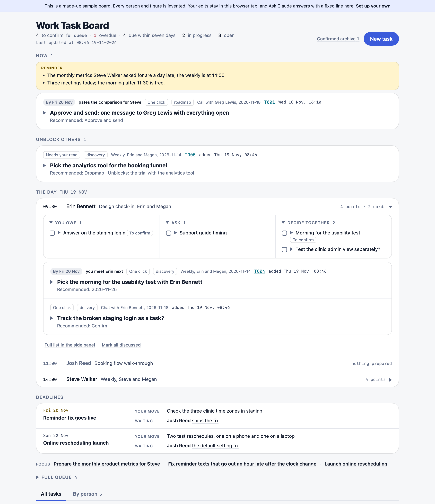

# Work Task Board kit

A private task board you run with Claude. This folder is a template: it holds the page, the scripts, the behaviour rules and an invented sample. `SETUP.md` is the prompt that builds your own copy through a guided interview of eleven questions.



Every person, company and figure in the picture is invented.

How I use it and why I built it: https://danielercohen.github.io/ai-pm/toolkit/work-task-board.html

## What the board is

- A Markdown table of tasks, `tasks.md`, is the source of truth. It lives in your own notes folder.
- A private page on claude.ai shows the table (Claude calls such a page an artifact). Each task opens a side panel with a description, the last decision, the updates log and its references.
- A **To confirm** queue holds decisions Claude has prepared for you: a drafted message, a comparison table, free time slots, or a plain question. You pick an option and press Send.
- A **day view** opens the page, written by the morning brief: **Now** (reminders and the cards a date depends on), **Unblock others** (quick answers that start someone else's work), **The day** (one row per meeting, read from your calendar, with what you owe, what to ask and what to decide together), **Deadlines** and the Top three as one **Focus** line.
- An **Ask Claude** box on the page adds, changes or closes tasks from a plain sentence.
- An **hourly job** files your meeting notes, applies the answers you gave on the page, prepares new cards and writes the brief. It reads, files and prepares, and it never sends or posts. Anything you approve for sending goes out from your next chat with Claude.
- A **brain** file, `BRAIN.md`, holds the rules for how Claude works for you: prepare first, ask second. The setup writes it from your answers. It is the most important file in the kit.

## What it needs

- Claude Code desktop, signed in to claude.ai.
- Artifacts with a database: the page stores its tasks, cards and brief in a small database that only you can open.
- For Ask Claude on the page: the page's permission to call Claude (the `sample` capability). Without it the page shows a New task button.
- A scheduled task in Claude Code (a prompt that runs by itself at set times) for the hourly job.
- Python 3.9 or later for the scripts. They use the standard library only.
- Optional: connectors, the links that let Claude read your calendar, mail and chat. Each one turns on a part of the job; the board works without them.

The setup checks each of these and tells you what is missing.

## What is in the folder

| File | What it is for |
|---|---|
| `SETUP.md` | The setup instructions Claude follows. It interviews you, then creates your folder, your brain, your page and your job. |
| `UPDATE.md` | For a board that already exists: the instructions Claude follows to bring it to this version of the kit. |
| `board/tasks-board.html` | The page. One config block at the top holds your name, the title, the default category and the statuses. |
| `board/sync_tasks.py` | Prepares the files that go from `tasks.md` to the page's database and applies the page's edits to `tasks.md`. Claude runs it; you do not need to. |
| `board/BRAIN.template.md` | The behaviour rules, with placeholders the setup fills from your answers. |
| `job/SKILL.template.md` | The hourly job. Meeting notes, the twice-daily read of mail and chat, the calendar and the weekly review are optional blocks. |
| `job/scripts/` | `hourly_precheck.py` lets an hour with nothing new stop at once; `efficiency_report.py` counts what the queue produced in a week. |
| `skill/sync-task-board.SKILL.template.md` | A manual "sync the board" command for when you edit `tasks.md` by hand. |
| `sample/` | Ten invented tasks in every status, their summaries, five cards and a brief for one invented day. Invented people, an invented company. |
| `docs/formats.md` | The task row, the summary file, the card and the brief: fields and one example each. |
| `tools/preview.py` | Shows the page on your computer with the sample or your own data. Nothing is published. With `--no-serve --out <folder>` it writes a static copy of the sample whose dates follow the visitor's today. |
| `tools/load_sample.py` | Copies the sample into a folder with its dates moved to today. |

## Versions

- **2026-11-18:** the day view at the top of the page (Now, Unblock others, The day, Deadlines, Focus) replaces the Top three panel, the per-person blocks and the To confirm list; a Copy button on drafted messages; card fields `slot`, `kind`, `person` and `unblocks`; brief fields `dayDate`, `reminders`, `deadlines` and meeting times; an hourly calendar check in the job. A board set up from the first version is updated with `UPDATE.md`.
- **2026-11-17:** first version.

## Try it before you set anything up

```bash
python3 tools/preview.py
```

Open http://localhost:8765/ to see the sample: the day view, the cards, the task groups and the side panel. Edits in the preview stay in the browser tab.

## Set it up

Open Claude Code in this folder and say: "Read SETUP.md and follow it." Claude asks eleven questions, one at a time, then builds your copy. It asks for your yes before it creates the folder, publishes the page, writes to its database, creates the scheduled job or writes anywhere outside the board folder.

## Status

- Tested: the scripts on the sample from a separate folder (`check`, `export`, `import`, the job helpers), and the page in a browser through `tools/preview.py` at desktop and phone width, in light and dark, with the sample and with an empty database.
- Tested on 2026-11-18: the day view through `tools/preview.py` with the sample (card placement, a tick, Send on a card inside a meeting row, the full queue, the Copy button present) at desktop width in light and at phone width in dark, with no errors in the browser console.
- Not yet tested: `UPDATE.md` on a board other than my own, where the same change was made by hand.
- Setup run, 18 November 2026: two Claude Code sessions in the Claude desktop app followed SETUP.md from start to finish with written answers, on my own account. One used the sample, the other an existing to-do list and a folder of meeting notes. Both built the board folder, published the page and filled its database. They used the page as it was before the day view and had no calendar connected.
- In both, the first run of the scheduled job stopped at once on a rule I have since removed. The corrected job then filed a meeting note, queued two cards and wrote the morning brief when a session followed the job file by hand. Its start from the scheduler has not run again.
- Not yet tested: a person other than me running the setup, a second account, Ask Claude on a newly set-up page, and the mail, chat and calendar sources outside my own board.
- The setup has not been timed with a person. If you run it, tell me how long it took.
- Every person, company, product and figure in `sample/` is invented.

## What stays private

Your tasks, notes, cards and brief live in your notes folder and in your own private page. The kit folder holds none of it and can be shared as it is.

## Licence

MIT. See LICENSE.
